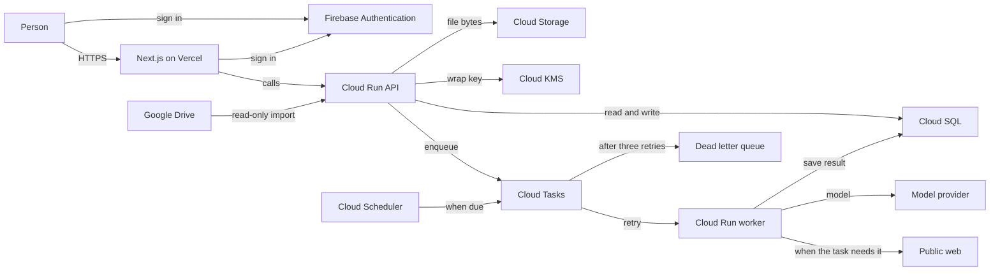
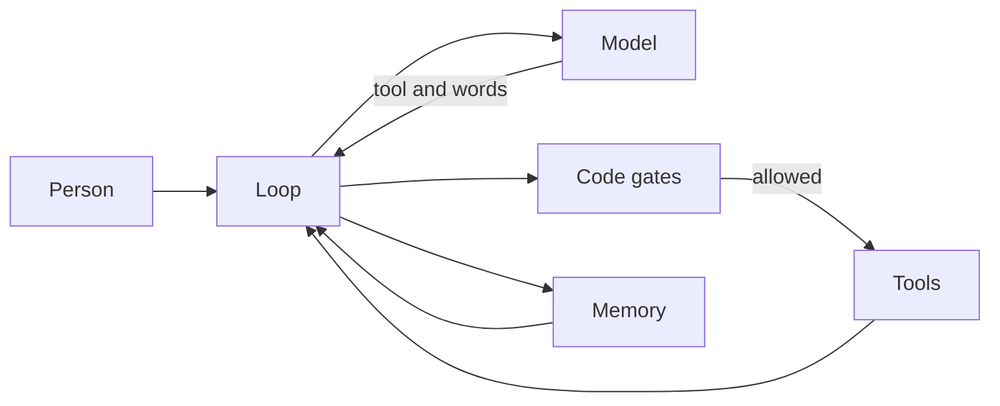

# Architecture

About 25 people, with room for a few hundred. One region: `us-central1`.

- Chat returns on the API request.
- Research and scheduled runs go through the queue. A dead provider is retried three times after the first attempt. The failed run then stays on the dead letter queue.
- Research and a scheduled run may read the public web when the task needs it.
- A file prefix belongs to one account. The platform holds the model keys.
- Vercel hosts the web app. Google Cloud holds data, jobs, keys, and the API. Terraform describes the Google Cloud resources. The website is the piece hosted outside Google Cloud.
- Firebase Authentication holds the sign-in. Postgres holds the account.
- GitHub Actions runs the checks. The deployment pipeline is stage 2.5, after one chat turn on this machine and before files. The website stays on Vercel. Terraform describes Google Cloud.

## Harness

The agent has tools and memory. The loop is project code. The model chooses the tool, the memory, and the words. Code runs a gate before the tool. The model does not decide that a gate passed.

- A gate is identity, authorization, the account, allowed ids, the schema, a repeated delivery, the source of a fact, and the caps and confirmations already written.
- The tools are file read, file write, Drive-copy read, public web read, browser read, a send on a website, and knowledge search.
- Memory is the knowledge files, the abilities, and the thread. Knowledge search matches words and opens at most five files. `profile.md` is included in every call.
