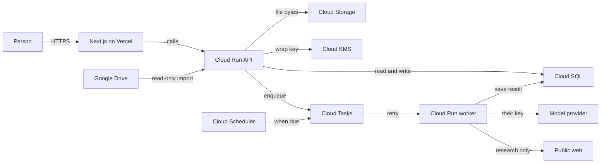

# Architecture

About 25 people, with room for a few hundred. One region: `us-central1`.

- Chat returns on the API request.
- Research and scheduled runs go through the queue.
- Research may read the public web. A scheduled run may not.
- A model key and a file prefix belong to one account.
- Vercel hosts the web app. Google Cloud holds data, jobs, keys, and the API.
