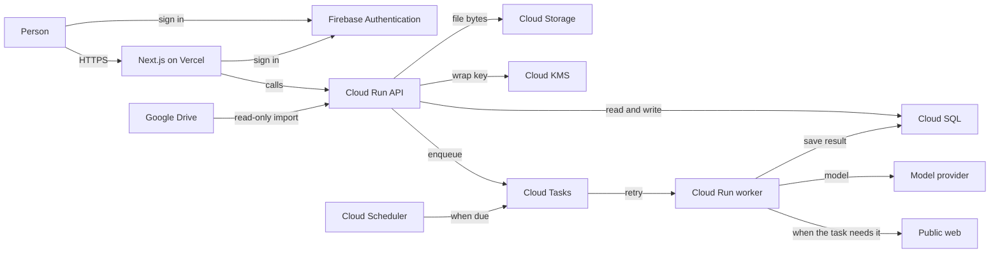

# Architecture

About 25 people, with room for a few hundred. One region: `us-central1`.

- Chat returns on the API request.
- Research and scheduled runs go through the queue.
- Research and a scheduled run may read the public web when the task needs it.
- A file prefix belongs to one account. The platform holds the model keys.
- Vercel hosts the web app. Google Cloud holds data, jobs, keys, and the API.
- Firebase Authentication holds the sign-in. Postgres holds the account.
