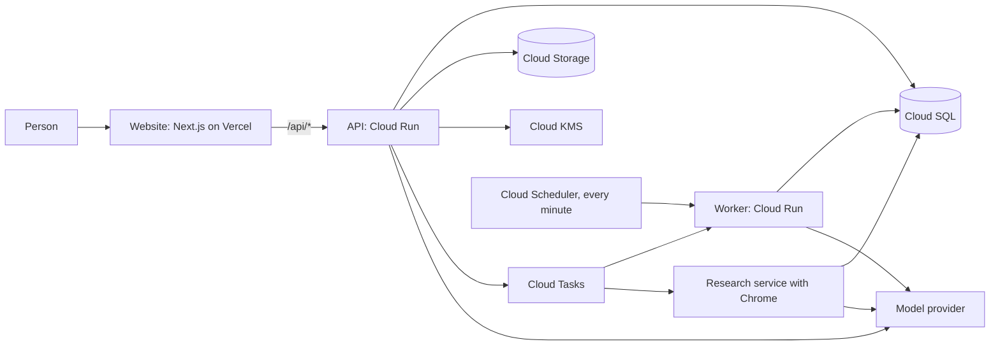

# Folio: hand-in report

Live site: https://folio.khamseaffan.com (invite only). Report date: 2026-11-16.

Folio is a private AI assistant that I built from scratch. This report follows the seven sections in `Goal.md`. Each section says what I chose, why, and when I would change it. Extra highlights are in the Appendix.

## How to read the states

I use three states and no others.

| State | Meaning |
| --- | --- |
| **Live** | Built, and I have used it on the live site. |
| **Tested only** | Built, and covered by automated tests that use fakes for outside services. I have not yet tried it on the live site. The live check is listed in Appendix A. |
| **Not built** | Not in the product. Section 4 says why. |

Facts used in this report:

- 819 backend tests pass. 17 are skipped in my local run, because they need Chrome, which the CI browser job provides.
- The frontend has lint, a type check and a build. It has no unit tests and no end to end tests. This is a known gap.

## 1. Service overview

Folio is an assistant for one person at a time. Each account is private. You sign in, talk to it, and it keeps notes about you and can work while you are away.

### What it does

| Feature | State |
| --- | --- |
| Accounts: sign in with Google or an email link, sign out, delete the account | Live |
| Chat in threads, replies that stream, a stop button, no limit on message length | Live |
| Memory: a profile and knowledge notes in Markdown, and "abilities" (ways of working the assistant remembers) | Live |
| Deep research: a report with a numbered source list, and a banner showing what it is reading | Live (the banner is in Appendix A) |
| Schedules: you say when, in the chat, and a worker runs the task | Live |
| A scheduled task can start a research run (one at a time per thread) | Tested only |
| Files: upload, download, and the model reads them | Tested only |
| Voice input: microphone to text | Tested only |
| Google Drive import: one file you pick, stored as a read-only copy | Tested only |
| The web for scheduled tasks, with a small budget | Tested only |
| An Integrations page and a Files page | Tested only |
| A privacy page | Live |

### Who can use it

- Only `khamseaffan@gmail.com` and any `@sakana.ai` address can create an account. Any other email is refused at sign-in.
- Sign-in is Google or a one-time email link. There are no passwords.
- A session ends after 24 hours of no activity. An account has at most two sessions. A third sign-in ends the oldest.
- Deleting an account is immediate and cannot be undone. It removes your files, threads, notes, schedules, sessions and sign-in record. It keeps the usage rows and the token cap for that email, so deleting and re-creating an account does not give a fresh allowance.

### Expected users and how the system is sized

I expect **about 25 users, with room for a few hundred**, in one region (`us-central1`). These are estimates, not load test results.

| Part | Setting (from `infra/`) | Why |
| --- | --- | --- |
| API | 0 to 3 instances | Chat is short. Three is far more than 25 people need. |
| Worker (schedules) | 0 to 2 instances. The queue runs at most 3 tasks at once. | Scheduled runs are rare and short. |
| Research service | 0 to 3 instances, one run per instance, 2 CPUs and 4 GiB each. The queue runs at most 3 at once. | Chrome needs memory. One run per instance keeps runs from fighting for it. |
| Database | PostgreSQL 18, smallest shared size (`db-f1-micro`), one zone, backups on | Cheap, and enough for 25 people. It is the first part to grow. |
| Files | 50 MB per file, 5 GB per account | A hard limit on storage per person. |
| Tokens | 10 million per email, by default | A hard limit on spend per person. |

In practice:

- Idle services cost nothing, because they scale to zero.
- One research run used about 650,000 tokens (about $1.60) and 7.5 minutes in the one run I measured. At that size one email can run roughly 15 research reports before reaching 10 million tokens. This is an estimate from one run.
- So heavy use is stopped by the token cap, not by running out of capacity. I can raise one email's cap by hand.

| Choice | Why | When I would change it |
| --- | --- | --- |
| Scale to zero, no warm instance | A warm instance costs money all month for 25 people. | Keep one instance warm once people complain about the slow first request. |
| One database zone, no failover | Failover roughly doubles the database cost. | Turn on high availability when users cannot lose an hour of work. |
| One region | Latency and cost are fine for this group. | Add a region only if users are far away or the service must survive a region outage. |

### Where I was creative

- **A small product with a hard budget.** Every limit (files, tokens, sources, pages, minutes) is a number in code or Terraform that a person can read and change. A personal assistant that browses the web and calls a paid model can spend money by accident. A visible limit is easier to trust than a promise.

## 2. Technology and architecture

### Pieces and reasons

| Piece | Choice | Why | When I would change it |
| --- | --- | --- | --- |
| Website | Next.js (React) on **Vercel** | Vercel is built for Next.js and gives a preview for every pull request. | Move it to Cloud Run if I need everything in one cloud or one bill. The change is small, because the website only calls `/api/*`. |
| API | Python 3.13, FastAPI, on Cloud Run | `Goal.md` asks for Python. Cloud Run scales to zero. | Add a warm instance when the first request is too slow. |
| Worker | Same image as the API, a second Cloud Run service, not public | The API is public. A route that starts work for any account must not be reachable from the internet. | Not needed at this size. |
| Research service | Own image (API plus Chrome), a third Cloud Run service, not public | A browser that opens addresses chosen by strangers should be apart from the service that runs schedules. Chrome also needs more memory. | Raise memory or instances after measuring more runs. |
| Database | Cloud SQL, PostgreSQL 18, private address | One place for accounts, messages, runs and usage. No public address. | Add failover (Section 1). |
| Files | Cloud Storage, one private bucket, a folder per account | Files do not belong in a database. | None expected. |
| Queues and clock | Cloud Tasks (two queues), Cloud Scheduler (every minute) | Retries, a limit on runs at once, and a second delivery if a worker dies. | None expected. |
| Sign-in | Firebase Authentication, sign-in only | I did not want to write or store passwords. Accounts, sessions and limits stay in my own database. | Replace it only if the allowlist model changes. |
| Keys and secrets | Cloud KMS for integration tokens, Secret Manager for app secrets | Each fits a different job (Section 7). | None expected. |
| Model | LangChain chat model called from a LangGraph loop | LangChain hides the provider. LangGraph runs the tool loop. | See "Any LLM" below. |
| Search | Tavily | A simple search API that returns titles and addresses. | Swap it behind the same function if cost or quality changes. |
| Infrastructure | Terraform in `infra/` | `Goal.md` asks for IaC. | None. |
| CI and CD | GitHub Actions, Vercel | Section 5. | None. |

### Everything on Google Cloud except the website

The API, worker, research service, database, file storage, queues, scheduler, secrets and encryption keys all run on Google Cloud and are created with Terraform. Only the website runs on Vercel. This was deliberate.

- **Why:** Vercel suits Next.js and gives previews. The website holds no data and no secrets. It forwards `/api/*` to the API.
- **Trade-off:** One piece lives outside Google Cloud, so there are two places to look when something breaks and one more account to manage.
- **Trigger to move it:** If a reviewer or customer needs the whole service in one cloud, or if Vercel's cost passes what a small Cloud Run service would cost, I would move it to Cloud Run.

### How a request moves

- A short chat is answered on the API request, so a reply feels immediate.
- Research and scheduled runs go on a queue and a worker picks them up. A report can take half an hour, and a request cannot wait that long.
- If a run fails, the queue tries again, up to 4 tries in all (`infra/worker.tf`, `infra/research.tf`). Then the run is marked dead in the database and the thread shows one line.
- Files go from the browser straight to the bucket with a signed address. The API never carries the bytes.

### "Any LLM" (`Goal.md`, functional requirement 1)

I want to be exact here.

- The model is reached through LangChain. The OpenAI, Anthropic and Google packages are installed (`backend/pyproject.toml`).
- The provider and model id are set in one place: `backend/app/model.py` and `backend/app/brain.py`. Today that is OpenAI and `gpt-6.1-sol`. Voice uses a second model, `gpt-4o-mini-transcribe`, set in `transcribe.py`.
- Changing the provider is a one-line configuration change plus a deploy. **There is no model picker in the app.** Users cannot choose a model.
- The agent loop, the tools and the memory do not depend on the provider.

| Choice | Why | When I would change it |
| --- | --- | --- |
| One platform model that I pay for | Cost and behaviour stay predictable for 25 people. No one has to paste in a key. | Build a picker when users ask for other models, or want to pay with their own key. |
| Provider set in code, not in settings | A settings screen needs storage, permissions and a test for each model, and adds little for 25 people. | Same trigger. |

### Where I was creative

- **A harness where code sets limits and the model chooses words and tools.** The model decides what to say and which tool to call. Code decides what is allowed: which account, which addresses, how many pages, how many tokens. The model never decides that a limit has passed. A rule that only the model is asked to keep is not a limit.
- **The database is the only place that knows what is due.** Schedules are rows with a next time (Section 3).
- **Direct to bucket uploads.** A Cloud Run request body is limited to 32 MiB, and I allow 50 MB files. The API signs a short-lived address and the browser sends the file straight to the bucket. Unfinished uploads sit under `pending/` and the bucket deletes them after a day.
- **Path filtered CI that still keeps required checks green** (Section 5).

## 3. Additional features and ingenuity

`Goal.md` asks for two or more original features. I built two and added more.

### Feature 1: long-term memory (Live)

- Notes are Markdown files. Your profile is read on every model call.
- The profile has a cap of 20,000 characters (about 5,000 tokens). The assistant is told when it is full and shortens it.
- Other notes are found by their words. One call opens at most five.
- You read notes in the Profile page and change them by telling the assistant.
- **Abilities** are ways of working that you teach in the chat and can remove in the chat.

| Choice | Why | When I would change it |
| --- | --- | --- |
| Plain Markdown notes, word search | Easy to read, edit and delete. No extra service. | Add an embedding index when people have hundreds of notes and word search misses them. |
| Profile cap of 20,000 characters | The profile is paid for on every message. Without a cap a huge profile could make every reply expensive or fail. | Raise it if people hit it often. |

### Feature 2: periodic autonomous execution (Live)

You say when, in the chat. There is no form. The assistant creates, changes and removes the schedule. It belongs to the thread, so deleting the thread deletes the schedule.

How a run happens:

1. Cloud Scheduler calls the worker once a minute (the "tick").
2. The worker finds schedules whose next time has come.
3. For each one, the model works out the next time from the person's own words, their time zone and the time now. Code stores it.
4. One run is queued. The queue calls the worker, which does the task and writes one message in the thread.
5. A failed run is tried 4 times in all, then marked dead. The thread shows one line.
6. A run stuck as working for 90 minutes, or queued for 30 minutes, is marked dead by a later tick.

| Choice | Why | When I would change it |
| --- | --- | --- |
| The model works out the next time, code fires it | "Every other Friday" and "the first working day of the month" are questions of meaning. Code would need a grammar for each phrase. | Use a fixed cron form if the model gets times wrong in real use. |
| A one-minute tick, not one queued task per schedule | The database is then the only place that knows what is due. A lost queue task cannot end a schedule for ever. | Change the interval if one minute is too coarse or too busy. |
| A queue between the tick and the run | The tick must finish in seconds and a run can take minutes. The queue also gives retries and a limit on runs at once. | None expected. |
| A scheduled run cannot create, change or delete schedules | A task cannot multiply itself and spend the token cap overnight. | Allow it only with a clear count limit. |
| One result per run | The run row id is the queued task name. The result message and `delivered_at` are saved in one transaction, so a second delivery sees it and stops. | None expected. |

### More features beyond the mandatory list

| Feature | State | Reason |
| --- | --- | --- |
| Research progress banner (shows what Folio is reading) | Live (confirm in Appendix A) | A 7 minute job needs a sign of life. |
| The web for scheduled tasks: 6 searches, 8 pages, 5 minutes, fetched through the safe proxy without Chrome | Tested only | A "morning briefing" task needs the web, but a scheduled task should stay cheap. A task that needs many sources starts research instead. |
| The assistant can write Markdown, text, CSV and PDF files | Tested only | A task result is often a file. |
| Files the model can read: text, CSV, spreadsheets, PDF, images | Tested only | Reading is what makes uploads useful. |
| Token totals and file space in settings, a per-email cap and a stop | Tokens live. Files tested only. | Control of spend. |
| Integrations page (connect, disconnect) | Tested only | A later integration is another row with its own secret and tools. |

### Where I was creative

- **The research source list is a promise.** A page that was not opened is not a source. Titles and addresses come from the pages, not from the model, so a reader can trust every source.
- **A schedule's next time is worked out by the model but fired by code.**
- **The token cap also counts stopped replies.** A provider sends token counts only at the end of a reply, so a stopped reply has none. Folio counts what it sent and what arrived, and marks the row as estimated. Without this, someone could stop every reply and never reach the cap. Letting the reply finish unseen would give exact counts but spend tokens on text nobody reads.
- **Usage rows store missing as missing.** If the provider gives no count, the row says so. Zero looks like a fact, and it is not one.
- **Page digests.** Each opened page becomes a short digest written by a separate call with no tools. The loop sends everything it has seen on every step, so twenty whole pages would make every later step heavy. The cost is that a fact the digest left out is not in the report.
- **Research limits from a measured run.** Up to 20 sources, 25 searches, 60 steps, 25 minutes of reading, 30 minutes in all. One real run opened 20 sources, used about 650,000 tokens (about $1.60) and 7.5 minutes. Later sources added less, because pages from one site repeated each other. No test has compared 10, 20 and 40 sources, so 20 is a reasoned start. It is one constant in `research.py`.

## 4. What I left out, and what I would do

For each item: why it is not built, and the trigger that would make me build it.

| Not built | Why | Trigger and plan |
| --- | --- | --- |
| Admin choice of model or provider in settings | One model is simpler and predictable. | Users ask for other models. Store the choice per account and record the model on every usage row (already done). |
| Website sends with a confirmation card (browser actions that submit forms) | The riskiest feature, and not required. A wrong send cannot be undone. | A real task needs it. Show a card for that exact site and those fields, expire it in 24 hours, mark it used before sending. |
| OCR for scanned PDFs | A scanned PDF has no text, and Folio says so. OCR adds a service and cost. | Users upload scans often. Run OCR in the worker and record a usage row. |
| PDFs written by the assistant draw only Latin characters | The built-in fonts cover Latin-1. Other characters become a question mark. | Users write in other scripts. Embed a Unicode font. |
| JavaScript heavy pages are read thinly by scheduled tasks | The worker has no Chrome, to stay small and cheap. Research uses Chrome and is fine. | Scheduled tasks often hit such pages. Send those pages to the research service. |
| Full export of an account | Not required. | A privacy request, or before opening to the public. Write one archive of notes, threads and files. |
| Organizations | One email is one private account. | A team wants to share notes. It needs a new ownership model, so it needs a design first. |
| Several named bots per account | Not required. | Users want separate roles. |
| Search across old threads, and editing sent messages | Not required. | Users with long histories ask for it. |
| Code execution in a sandbox | A large security surface. | A task needs computation that tools cannot do. Use a separate sandbox service with no network. |
| A staging environment | One person, one pipeline. A merge to `main` deploys to the one live site. | A second developer joins, or a change needs a trial with real data. Add a second Terraform environment and deploy `main` there first. |
| Alerts, dashboards, an uptime check | Section 6. | Section 6. |
| Frontend unit and end to end tests | Time. The frontend is a thin layer over the API. | Before the next feature with client logic. Start with a browser test of sign-in and chat. |
| A warm instance and database failover | Cost, a deliberate choice (Section 1). | Section 1. |

### Where I was creative

- I wrote the "not built" list as **triggers, not promises.** Each line says what would make it worth doing. This keeps the product small on purpose.

## 5. Quality assurance and testing

### The pipeline

- Changes reach `main` only by pull request. `main` is protected.
- Four checks must pass: **backend** (Ruff lint, then pytest against a real PostgreSQL 18), **frontend** (lint, type check, build), **terraform** (`fmt` and `validate`) and **docker** (builds the API and research images). A fifth job, **browser**, runs the real Chrome tests.
- A **change detection** job decides which checks have anything to check. A skipped job counts as passed, so a README-only change is still green. If the changed files cannot be listed, every check runs. A change to the workflow runs everything.
- **Pre-commit hooks** run Ruff, pytest, lint and type check before a commit.
- Large work is split into **stacked pull requests**, so each one is small enough to read.
- Each merge **deploys by itself** (`deploy.yml`): build the image, run the database migration, deploy the API, worker and research service, then check that `https://folio.khamseaffan.com/api/ready` answers. Only the newest commit on `main` is deployed. Vercel builds the website.
- Deploys sign in to Google with workload identity tied to this repository and the `main` branch. No deploy key is stored. I apply Terraform myself after I read the plan, so the pipeline never holds infrastructure admin power.

### How features are tested

- **Tests are written first** for features.
- **Every outside service has a fake**: the model, search, web pages, Google (Drive), Cloud KMS and the bucket. The suite is fast and free and runs on every pull request.
- A **real PostgreSQL** runs in CI, so database behaviour (transactions, locks, constraints) is tested for real.
- Limits are tested as rules, for example: a second delivery does not write a second result, a deleted account removes its files, a missing usage count is stored as missing, a stopped reply counts toward the cap, and a private or metadata address is refused by the proxy.

| Choice | Why | When I would change it |
| --- | --- | --- |
| Fakes for outside services | Fast, free, and the same result every time. | Keep them. Add a small live test run on top. |
| Real Postgres in CI | A mock database hides the bugs that matter here, such as locks. | None. |
| One pipeline, merge deploys | One developer, small risk. | Add staging when a second developer joins (Section 4). |
| Required checks plus path filtering | Fast feedback, and no waiting on checks that cannot fail. | None. |

### Honest limits

- **Real outside services are not exercised in CI.** The model, Google Drive, voice transcription, Cloud KMS and the real bucket are tested with fakes. Appendix A lists what I still have to check by hand on the live site.
- **The frontend has no unit tests and no end to end tests.** It has lint, a type check and a build. This is the weakest part of the test setup.
- **No load test has been run.** The sizing in Section 1 comes from settings and one measured research run.

### Where I was creative

- **Path filtered CI that still keeps required checks green.** A skipped job reports as passed, so a required check never blocks a change that has nothing to check. I did this to keep feedback fast without weakening the gate.
- **The test double for KMS refuses the wrong account.** The fake rejects a secret opened with a different context, so the account binding in Section 7 is exercised in tests, not assumed.

## 6. Monitoring and logging

### What exists today

| Part | What it does | State |
| --- | --- | --- |
| Application logs | The API, worker and research service write to Cloud Logging. A line names the account, run or operation. | Live |
| What logs leave out | Message text, notes, file contents, prompts, keys, cookies and magic links. Errors log the type of the error, not its text. | Live |
| Usage rows | One row for every model call, every search and every transcription: account, time, operation, provider, model, tokens, expected cost. A missing count is stored as missing. | Live (voice: tested only) |
| Failed-runs record | A run that fails 4 times is marked `dead` in the `run` table with its task and attempt count. The thread shows one line. | Live |
| Health routes | `/health` (the service is up) and `/ready` (the database answers, else 503). The deploy workflow calls `/api/ready` after each deploy. | Live |
| Cloud Run's own metrics | Requests, errors, latency and instance counts, from Google. | Live |
| Alert policies, an uptime check, a dashboard | `infra/` has no monitoring resources. | Not built |

Known gap: calls to Cloud KMS have no usage row.

### What is not built, and the design

Today nobody is paged. I find out about a problem by looking, or from a user. For 25 people I accepted this, to keep cost and moving parts down.

The design I would add in Terraform:

1. An **uptime check** on `https://folio.khamseaffan.com/api/ready`, every minute.
2. An **alert on error rate**: Cloud Run 5xx responses above a small share over 5 minutes.
3. An **alert on a dead run**: a log based metric on the log line "is dead after N attempts" written by `scheduled.py` and `research.py`.
4. A **notification channel**: email to me.

| Choice | Why | When I would change it |
| --- | --- | --- |
| Logs without message text | A log is read by more people than a thread is, and it lasts longer. | None. |
| Usage rows instead of an analytics product | The request log, the run row and the usage row answer "who spent what". | Add analytics when I need product questions answered. |
| No alerts yet | Time and cost for 25 people. | Build the four items when the first outside person depends on the site, or when a failure goes unnoticed for a day. |

### Where I was creative

- **A failed run is never silent.** Each run type ends in a visible line in the thread and a log line with the run id, so the person and I both see it.
- **Logs by account and run id, without content.** I can follow one run across services without reading anyone's messages.

## 7. Security

### What the code and infrastructure do

| Area | Measure |
| --- | --- |
| Who gets in | Allowlist (`khamseaffan@gmail.com` and `@sakana.ai`). No passwords. Google or a one-time link proves the address. |
| Sessions | Ended after 24 hours idle. At most two. The cookie is `HttpOnly` and `SameSite=Lax`. The page never receives a session id. The settings screen names a session by a hash. |
| Changes from other sites | Every `POST`, `PATCH`, `PUT` and `DELETE` is refused when its origin is not Folio. The check runs before any route. |
| Isolation | Every query is scoped to the account. Files live in a folder per account. |
| Spend limits | Token cap per email (10 million by default), a stop switch for me, 50 MB per file, 5 GB per account. |
| Integration tokens | The Google Drive token is encrypted with Cloud KMS. The account id is bound into the ciphertext, so a token copied to another account will not decrypt. Disconnecting removes the token. |
| App secrets | In Secret Manager. The Gemini and Drive secrets go only to the API. |
| Database | Private address only, TLS required, generated password held in Secret Manager. |
| Files | One private bucket, public access blocked. Upload and download use signed addresses that expire in 30 minutes. |
| Reading web pages | The research browser goes through a proxy that refuses private addresses and the cloud metadata service. The proxy looks up each name once, checks every answer, and connects to an address it checked. The model can only open addresses it was shown in a search result or on a page it opened. Page text goes only to a call with no tools. Scheduled tasks fetch pages through the same proxy. |
| Deleting an account | Removes its files, rows, sessions and sign-in. |
| Service accounts | One per service, with only the roles it needs. The research service can read only the database URL, the model key and the search key. The worker and research services are not public. Only `folio-invoker` can call them. |
| Deploys | Workload identity, tied to this repository and the `main` branch. No stored key. |

### Choices and reasons

| Choice | Why | When I would change it |
| --- | --- | --- |
| Allowlist plus Firebase sign-in | I do not store passwords. Only people I invite can join. | Add an admin screen for the allowlist when invitations are frequent. |
| Proxy that connects to the address it checked | A check made before Chrome connects can be fooled by a name that answers differently the second time, or by a redirect to a private address. The metadata service holds tokens that reach our secrets. | None. |
| Per-account bound encryption | A leaked row cannot be used under another account. | Add more keys if I add integrations with different risk. |
| No static outbound address or Cloud NAT | Nothing outside Google Cloud needs to allow our address. | Add one if a partner asks for it. |

### Weak points I know about

- **A Drive import holds up to 50 MB in memory.** The download is counted as it streams and stops at the limit, but the bytes sit in memory before they are saved. The API runs on the default instance size, so several imports at once could be a problem.
- **KMS calls have no usage rows.** They are cheap but not recorded.
- **Page text can contain instructions.** I reduced the risk (a digest call with no tools, only shown addresses, a proxy), but I cannot prove that a model will never follow a bad instruction. The limits are what keep the damage small.
- **The model key is given to three services.** The API, the worker and the research service each hold the OpenAI key. A bug in any of them could leak it into a log. Model errors strip known keys from their text (`model.py`), but this is a place to watch.
- **Alerts are not built.** A slow problem would be noticed by me, not by a system.
- **The database is on the smallest shared size.** A burst could slow everyone down.
- **No external security test.** Nobody else has tested the service.

### Where I was creative

- **A harness with code gates.** The model picks the words and the tool. Code checks the account, the address, the budget and the schema before a tool runs.
- **The research source list is a promise**, so a bad page cannot add a fake source.
- **The proxy connects to the address it checked.**
- **Account-bound encryption** and **no session id in the page.**

## Appendix

### A. Live checks

These items are built and tested with fakes, and I have not yet tried them on the live site. I am testing them now. The Result column is for me to fill in.

| What | How to check | Result |
| --- | --- | --- |
| Upload a file of each kind (text, CSV, spreadsheet, PDF, image) and ask a question about it | Files page, then ask in chat. Confirm the answer uses the file. | to fill in |
| Upload a 50 MB file, then a file over the limit | The first works. The second is refused with a clear line. | to fill in |
| Download a file from the Files page | The signed address works. | to fill in |
| Ask the assistant to write a Markdown, CSV and PDF file | The file appears in Files and downloads. | to fill in |
| Voice input | Press the microphone, speak, see text in the composer. Check one usage row for transcription and that no audio is kept. | to fill in |
| Connect Google Drive | Integrations page, grant access, pick one file in Google's picker, see a read-only copy in Files. | to fill in |
| Disconnect Google Drive | Disconnect, confirm the token row is gone, and that a later import asks again. | to fill in |
| Scheduled task that uses the web | Schedule a task such as "every morning, find news on a topic". Confirm the result cites pages and the usage rows show the searches. | to fill in |
| A schedule that starts a research run | Schedule a task that asks for a report. Confirm one run starts and a second is not started while it works. | to fill in |
| Research progress banner | Start research and confirm the banner shows what is being read. | to fill in |
| Delete an account that has files | Create an account, upload a file, delete the account, confirm the bucket folder is empty. | to fill in |
| The privacy page | Open `/privacy` while signed out. | to fill in |

### B. How to run it

See [README.md](../../README.md), section "Run it locally". It covers the API, the worker, the research service and the website.

### C. Requirements from `Goal.md` and where each is met

| `Goal.md` line | Section | State |
| --- | --- | --- |
| Functional: instruct any LLM in conversation and receive responses | 1, 2 | Live. One platform model. The provider changes by configuration and deploy. No picker. |
| Functional: deep research reports | 1, 3 | Live |
| Functional: create, log in, log out and delete own account | 1, 7 | Live (delete with files: Appendix A) |
| Functional: inputs other than text, voice | 1 | Tested only |
| Functional: inputs other than text, files | 1 | Tested only |
| Functional: inputs other than text, Google Drive | 1 | Tested only |
| Functional: two or more original features, long-term memory | 3 | Live |
| Functional: two or more original features, periodic autonomous execution | 3 | Live |
| Non-functional: usable as a web application | 1, 2 | Live |
| Non-functional: access only for specific users | 1, 7 | Live |
| Non-functional: expected number of users and production-ready design | 1 | Live. About 25 users, room for a few hundred. Failover and alerts not built. |
| Technical: Python backend | 2 | Live |
| Technical: React or React-based frontend | 2 | Live (Next.js) |
| Technical: Google Cloud with IaC | 2 | Live. Only the website runs on Vercel. |
| Technical: continuous QA with CI | 5 | Live |
| Technical: automated deployment with CD | 5 | Live |
| Optional: extra features and UX | 3 | Live or tested only, as listed |
| Optional: innovation in the development process | 5, Appendix D | Live |
| Report: service overview | 1 | Done |
| Report: technology and architecture | 2 | Done |
| Report: additional features and ingenuity | 3 | Done |
| Report: parts omitted and the policy to implement them | 4 | Done |
| Report: quality assurance and testing strategy | 5 | Done |
| Report: monitoring and logging design | 6 | Done. Alerts not built, design given. |
| Report: security measures | 7 | Done |
| Report: creativity and reasons in each section | 1 to 7 | Done |
| Report: other highlights in an appendix | Appendix D | Done |
| Deliverable: URL of the web application | Top of this report | https://folio.khamseaffan.com |
| Deliverable: report | This file | `docs/hand-in/report.md` |
| Deliverable: source code on GitHub (private is fine) | Not part of this report | The repository is private. **Still to do:** add the reviewers as collaborators after submission. |

### D. Other highlights

- **One author, end to end.** The product, the infrastructure, the pipeline and this report are by one person. The design is written in `docs/decisions.md`, `docs/architecture.md` and `docs/product/`.
- **Decisions come before code.** `AGENTS.md` requires evidence before a change to records or storage, and a discussion before any new fixed rule. Code limits are the exception, not the habit.
- **Limits are numbers.** Every limit in this report is a constant or a Terraform setting, so a reviewer can find it and change it.
- **Cost is measured.** Every billable call writes a usage row. I used one measured research run to set the research limits.
- **Older documents differ from the code in a few places.** Some design pages still describe a model picker, confirmation cards and a dead letter queue. None of these is built. The code and `infra/` are the truth, and this report follows them.
