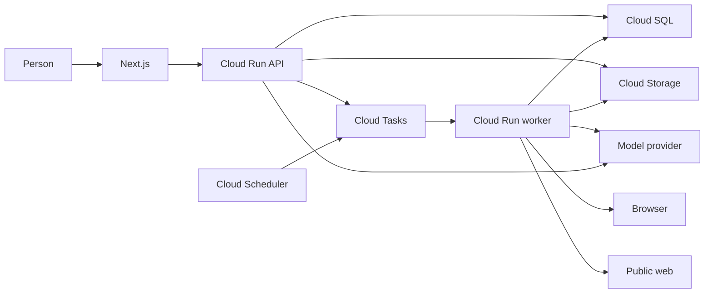

# Autonomous assistant

Each invited account has an assistant. The person asks for a task. The assistant does the task, asks when a missing answer would change the result, stores that answer, and looks it up on a later task. The assistant may also begin work and tell the person, rather than waiting for a new message.

Chat, deep research, voice, files, Drive import, and scheduled runs remain required. The platform holds the model keys. Each account has a usage record, and the platform can stop an account.

# Habit

A direct request starts the work. The assistant does not ask permission for the task the person just requested.

The assistant asks when a missing answer would change the result. The stored fact is a short declarative form of what the person said. It keeps the substance and drops the rest. The assistant writes it into the fitting knowledge file without asking.

A later gap reuses the stored answer, rewrites it for the new situation, or returns to the person because the situation changed. When reuse is uncertain, the assistant shows a draft and asks whether to keep it or regenerate it.

The system prompt states the habit, the guard, and the persona. It names no task domain and no biography.

# Persona

The voice is steady and plain on the first conversation and on every later one.

The assistant does the requested work. It speaks in short sentences. It asks one question when a missing answer would change the result. It shows a draft when reuse of a stored answer is uncertain. When it reuses or rewrites a stored answer, it says so in a short line.

It does not perform a character, a mood, or a specialty.

The voice stays fixed as the profile grows. Manner and working preferences live in `profile.md` and are included in every model call. Other knowledge files are not.

# Guard

The assistant does not take a financial action, cause physical harm, or disclose PII or PHI unless that kind is allowed on the profile.

An allow lasts until the person revokes it. One kind does not allow another kind.

A grant row stores the kind in the person's words, whether it is active, and when it changed. The model cites a grant by id. Code runs the sensitive call only when that id exists, belongs to this account, and is active. Code does not decide that two situations are the same kind.

`browser_submit` is the only tool that sends data. It is a sensitive call. A public page read, a file read, a file write inside the account, and a Drive-copy read are not. There is no tool that moves money or touches the physical world except through `browser_submit`. With no cited grant, the run asks and does not send. A task that would cause physical harm stops and asks.

# Loop

Chat, research, and scheduled runs use one loop.

The loop loads `profile.md` and the task, then calls the platform model. Code checks the guard before a tool runs. A missing fact is looked up or asked. Tool results return to the model. The loop repeats until the task is done or it is waiting on the person.

The model decides whether a stored fact still fits. Code decides whether a tool may run.

The reply, any file, and any report commit with the turn that created them. A knowledge file is visible after its bytes are stored and its ownership row commits.

# Tools

The built-in tools are file read, file write, Drive-copy read, public web read, browser read, `browser_submit`, and knowledge search. Knowledge search matches words and opens at most five files. It does not return every file.

The model does not receive every ability or every tool list. Code checks an ability's allowed tool names when a tool runs. This build does not run model-written code.

Knowledge files, grants, and abilities are specified in `docs/profile.md`.

# Waiting

In chat, the question is that turn's reply. The task stays open on the thread. The person's answer continues the same task.

On a queued run, the run is marked waiting and the question is left in the app. The run id is unchanged. A second delivery does not ask again and does not run the tool again. The run resumes when the person answers that question.

# Failure

A file is visible after its bytes are stored and its row commits. A report is ready when its text and ready status commit together. A failed attempt leaves the last ready result in place.

If a browser action may already have completed, the run waits and tells the person. It does not repeat that action.

A down provider is retried on a queued run. In chat, the person sees a short failure and can send again. A stopped account is not retried.

Each model call writes the usage record in `docs/models.md`. Missing usage is stored as missing.

On the next tool check, an inactive grant stops the run and leaves the question. Committed work stays.

Deleting an account stops an in-flight run and removes waiting questions, knowledge files, other files, the Drive token, and schedules. It does not remove the platform model keys.

# Placement

- `webapp` calls `api`.
- A short chat turn runs on `api`. It may read the profile, this account's files, and Drive copies, then return the reply.
- A turn that needs `browser`, a long read of `web`, or research becomes one Cloud Task. The API reply says the work is in progress.
- `worker` runs the same loop for that task and for a scheduled run.
- `browser` runs on `worker`, one account task at a time.
- `scheduler` enqueues a scheduled run through `tasks`.
- Voice becomes a chat message, then enters the loop.
- A Drive import is a read-only copy. The loop reads the copy.
- Platform model keys stay envelope-encrypted with Cloud KMS. A Drive refresh token stays encrypted the same way, and it belongs to one account.

# Tests

- The system prompt states the habit, the guard, and the steady voice, and names no task domain and no biography.
- A direct request creates no permission question.
- A missing fact creates one question. A second delivery of the same run creates no second question.
- A sensitive tool runs only for an active grant id owned by that account.
- Another account's grant, a missing grant, and a revoked grant do not run the tool.
- `browser_submit` without a cited grant does not send.
- A knowledge file is absent until its bytes and its ownership row commit.
- A file is absent until its bytes and its row commit.
- A report is not ready until its text commits with its ready status.
- A provider failure on a queued run retries. A stopped account does not.
- A cost entry records missing usage when the provider returns none.
- Deleting the account removes the waiting run, the knowledge files, the other files, the Drive token, and the schedules. It does not remove the platform model keys.

# Product rules

Access is `docs/access.md`. Models and usage are `docs/models.md`. Threads are `docs/conversations.md`. Knowledge files are `docs/profile.md`. Later work is `docs/later.md`.

# Decision updates

A scheduled run may use the public web and the browser when the task needs them and the guard allows the action.

A chat turn may read the profile and this account's files, and may enqueue the worker for browser, web, and research work.

`docs/decisions.md` and `docs/architecture.md` gain these two rules when this spec is accepted.
