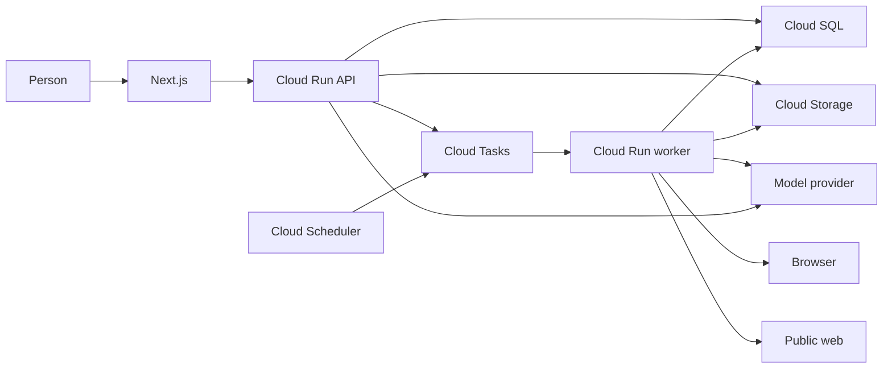

# Autonomous assistant

Each invited account has an assistant. The person asks for a task. The assistant does the task, asks when a missing answer would change the result, stores that answer, and looks it up on a later task. The assistant may also begin work and tell the person, rather than waiting for a new message.

Chat, deep research, voice, files, Drive import, and scheduled runs remain required. The platform holds the model keys. Each account has a usage record, and the platform can stop an account.

# Habit

A direct request starts the work. The assistant does not ask permission for the task the person just requested.

The assistant asks when a missing answer would change the result. The stored answer is a short declarative form of what the person said. It keeps the substance and drops the rest. Code writes that answer in the turn where the person confirmed it.

A later gap reuses the stored answer, rewrites it for the new situation, or returns to the person because the situation changed. When reuse is uncertain, the assistant shows a draft and asks whether to keep it or regenerate it.

The system prompt states the habit, the guard, and the persona. It names no task domain and no biography.

# Persona

The voice is steady and plain on the first conversation and on every later one.

The assistant does the requested work. It speaks in short sentences. It asks one question when a missing answer would change the result. It shows a draft when reuse of a stored answer is uncertain. When it reuses or rewrites a stored answer, it says so in a short line.

It does not perform a character, a mood, or a specialty.

The voice stays fixed as the profile grows. Manner and working preferences are stored when the person states them. Those preferences are included in every model call. Other answers are not.

# Guard

The assistant does not take a financial action, cause physical harm, or disclose PII or PHI unless that kind is allowed on the profile.

An allow lasts until the person revokes it. One kind does not allow another kind.

A grant row stores the kind in the person's words, whether it is active, and when it changed. The model cites a grant by id. Code runs the sensitive call only when that id exists, belongs to this account, and is active. Code does not decide that two situations are the same kind.

`browser_submit` is the only tool that sends data. It is a sensitive call. A public page read, a file read, a file write inside the account, and a Drive-copy read are not. There is no tool that moves money or touches the physical world except through `browser_submit`. With no cited grant, the run asks and does not send. A task that would cause physical harm stops and asks.

# Loop

Chat, research, and scheduled runs use one loop.

The loop loads the profile and the task, then calls the account's model. Code checks the guard before a tool runs. A missing fact is taken from the profile or asked. Tool results return to the model. The loop repeats until the task is done or it is waiting on the person.

The model decides whether a stored answer still fits. Code decides whether a tool may run.

The reply, any file, any report, and any new profile row commit with the turn that created them.

# Tools

The built-in tools are file read, file write, Drive-copy read, public web read, browser read, `browser_submit`, and answer lookup. Answer lookup searches and opens the answer files the task needs. It does not return every answer.

The model does not write the profile. Code writes an answer, a grant, or an ability in the turn where the person confirmed it.

An ability stores what it does, how it works, and which built-in tools it may use. It exists after the person confirms it. The same loop calls it. It runs no private code.

# Profile

The product language is English.

There is no cap on how many answers an account may keep.

Each answer is one text file for that account. The words live in the file. A database row records the owner and that the file exists, so the person can list, edit, and delete one answer, and so one account cannot read another's file. Deleting a thread does not delete these files.

The model is not given every answer. It looks up the files the task needs. Manner and working preferences are the exception: that file is included in every model call.

The person can open the profile, read what is stored, edit an answer by hand, and delete any answer.

When two answers disagree, the assistant tells the person and says which one it believes should go. It deletes an answer only after the person confirms. The person may name the old one, the new one, or confirm the assistant's choice.

A grant is a database row. It stores the sensitive kind, its active state, and the time of the change.

An ability stores the confirmed definition.

# Waiting

In chat, the question is that turn's reply. The task stays open on the thread. The person's answer continues the same task.

On a queued run, the run is marked waiting and the question is left in the app. The run id is unchanged. A second delivery does not ask again and does not run the tool again. The run resumes when the person answers that question.

# Failure

A file is visible after its bytes are stored and its row commits. A report is ready when its text and ready status commit together. A failed attempt leaves the last ready result in place.

If a browser action may already have completed, the run waits and tells the person. It does not repeat that action.

A down provider is retried on a queued run. In chat, the person sees a short failure and can send again. A stopped account is not retried.

Each model call writes a cost entry naming the account, the feature (`chat`, `research`, or `schedule`), the operation (`model_call`), the provider, and the model. Missing usage is stored as missing.

On the next tool check, an inactive grant stops the run and leaves the question. Committed work stays.

Deleting an account stops an in-flight run and removes waiting questions, profile rows, files, keys, and schedules.

# Placement

- `webapp` calls `api`.
- A short chat turn runs on `api`. It may read the profile, this account's files, and Drive copies, then return the reply.
- A turn that needs `browser`, a long read of `web`, or research becomes one Cloud Task. The API reply says the work is in progress.
- `worker` runs the same loop for that task and for a scheduled run.
- `browser` runs on `worker`, one account task at a time.
- `scheduler` enqueues a scheduled run through `tasks`.
- Voice becomes a chat message, then enters the loop.
- A Drive import is a read-only copy. The loop reads the copy.
- Platform model keys stay envelope-encrypted with Cloud KMS. A Drive refresh token stays encrypted the same way, and it belongs to one account.

# Tests

- The system prompt states the habit, the guard, and the steady voice, and names no task domain and no biography.
- A direct request creates no permission question.
- A missing fact creates one question. A second delivery of the same run creates no second question.
- A sensitive tool runs only for an active grant id owned by that account.
- Another account's grant, a missing grant, and a revoked grant do not run the tool.
- `browser_submit` without a cited grant does not send.
- An answer row exists only after the confirming turn commits.
- A file is absent until its bytes and its row commit.
- A report is not ready until its text commits with its ready status.
- A provider failure on a queued run retries. A stopped account does not.
- A cost entry records missing usage when the provider returns none.
- Deleting the account removes the waiting run, the profile, the files, the keys, and the schedules.

# Model keys

The platform owns the provider keys. A person does not bring a key, store a key, or replace a key.

The platform has one default model. Chat, research, and scheduled runs use that model. The person cannot change it.

Every model call writes a usage record for that account. An internal tool can read that usage and stop an account. A stopped account cannot start a chat turn, a research run, or a scheduled run.

# Access

An account requires an email address. One email holds one account.

An account can be created only for one named address the owner supplies, or for an address at `sakana.ai`.

Any account may create an invite. An invite is one person and one use. It expires after one week. It can be revoked before use.

The person signs in with Google or a magic link. The email is verified by that sign-in. The account stores no password.

The person sets a display name.

A session ends after 30 minutes of inactivity. An account may have two sessions at once. The person can see those sessions and end one.

Accounts are personal. There is no admin who can open another account's data.

# Conversations

An account has many threads. The person can create a thread, name it, rename it, and delete it.

Deleting a thread does not delete profile answers.

A chat reply is streamed as tokens arrive. The person can stop a turn while it is streaming. The provider call stops. The partial reply is kept.

A thread has one summary. When the thread is summarized again, the new summary replaces the old one. The new summary is written from the old summary plus the turns being folded in.

The model receives the summary and the latest 20 messages in full. Older messages stay in the thread and are not sent again in full.

# Later

One account may later have several named bots. That is not part of this build. One email still holds one account.

Thread search, a limit on the length of one message, and editing an earlier message are not part of this build.

# Decision updates

A scheduled run may use the public web and the browser when the task needs them and the guard allows the action.

A chat turn may read the profile and this account's files, and may enqueue the worker for browser, web, and research work.

`docs/decisions.md` and `docs/architecture.md` gain these two rules when this spec is accepted.
